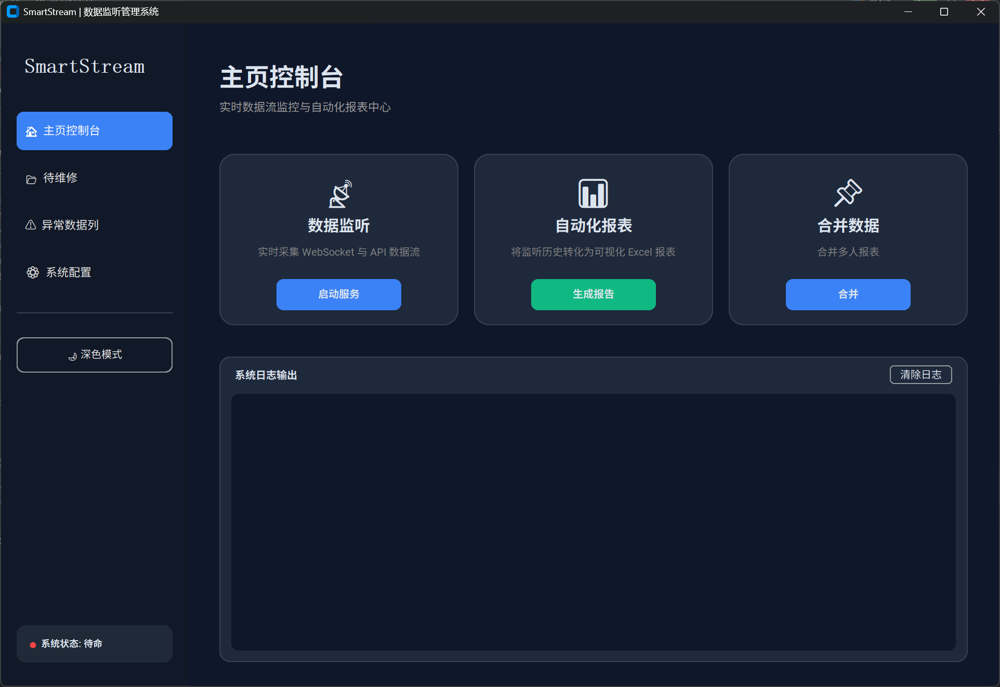

# 项目说明

**概述**：自动化报表合成，利用即时通讯平台，约定的群消息的格式，来批量化生成报表。

有一套完整异常处理机制，异常数据缓存本地，人工在UI界面处理后再重新流入自动生成报表。面对峰值吞吐量，可进入缓冲池，排队缓存本地。细颗粒度的IO
消费锁，保障数据的安全性的同时性能并没有下降很多。

## 1.2.1

版本说明：数据流不稳定，用户自定义的可扩展性差。

- bug修复
  - 本地图片，路径定位不准确
  - 峰值吞吐量，缓冲池被写满

# 7.2号

## 已知的bug

1. 每年，每月路径需要自动更新，月初的照片需要到的上个月找
2. 并发量的解决（问题源暂时不知道）
3. 对于数据控制，经常报nonetype错误（问题源不知道）

路径问题解决，解决方案：每月由人手动更改配置文件
NoneType报错原因：异步时，多协程对象读写一个文件，导致的I/O异常，解决方案：加入颗粒度为文件单位的互斥锁

## 2.0.2

整个项目重构，将函数式编程重构成面向对象；将数据类封装，提高了代码的可读性，可复用性；工具类封装后，代码结构变得清晰；

待重构模块： 合并功能，待维修界面
